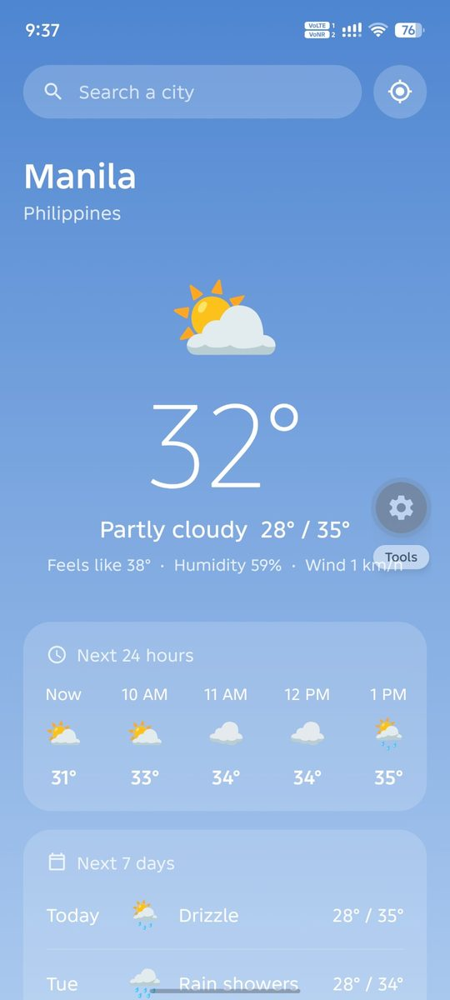
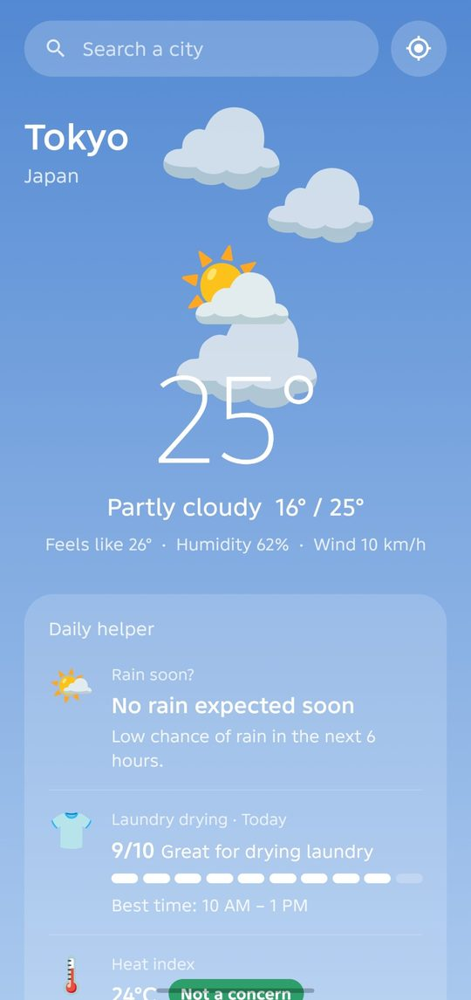
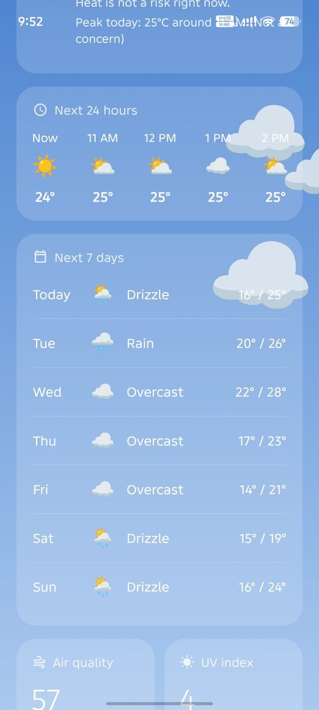
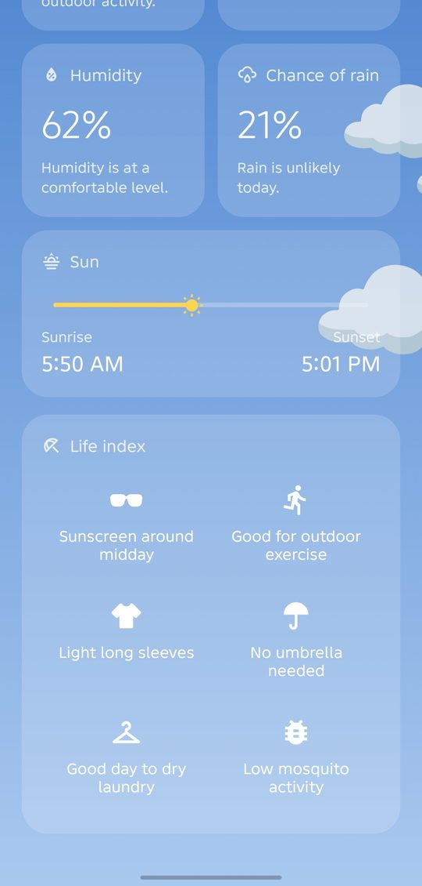

# Weather

A weather app that runs on both **mobile and web**, built with **React Native (Expo)**.

Search any city or use your location to see live weather. The background and animations
change with the sky, and a **Daily helper** answers everyday questions like
"Will it rain?", "Is it a good time to hang laundry?" and "How hot does it really feel?"

## Screenshots

<p>
  
  
  
  
</p>

## Features

- **Search or GPS**: find any city, or tap the location button to use where you are
- **Live sky**: the background color, moving clouds and falling rain match the current weather
- **Hourly and 7-day forecast**: temperature, conditions and rain chance
- **Details**: air quality (AQI), UV index, humidity, rain chance, sunrise and sunset
- **Life index**: quick tips for going outside, based on the current weather
- **Daily helper**
  - **Rain countdown**: when rain is expected in the next hours
  - **Laundry meter**: the best 3-hour window today to dry clothes outside
  - **Heat index**: how hot it feels, with PAGASA warning levels
  - Shows Filipino labels (Uulan ba?, Sampay meter) when the location is in the Philippines
- **Pull to refresh** and a friendly message when there's no internet

## Built with

- React Native + Expo (one codebase for Android, iOS and web)
- JavaScript, React hooks (`useState`, `useEffect`, `useRef`, custom hooks)
- Open-Meteo APIs: forecast, geocoding and air quality (free, no API key)
- expo-location, expo-linear-gradient, Animated API

## Run it on your computer

You need [Node.js](https://nodejs.org) installed (LTS version).

```bash
npm install          # first time only
npx expo start       # scan the QR code with Expo Go on your phone
npx expo start --web # or open it in the browser
```

## Credits

Weather data by [Open-Meteo.com](https://open-meteo.com) (CC BY 4.0).

Made by Sean Yumul Tiglao.

Live app: https://weather-app-seven-vert-37.vercel.app
